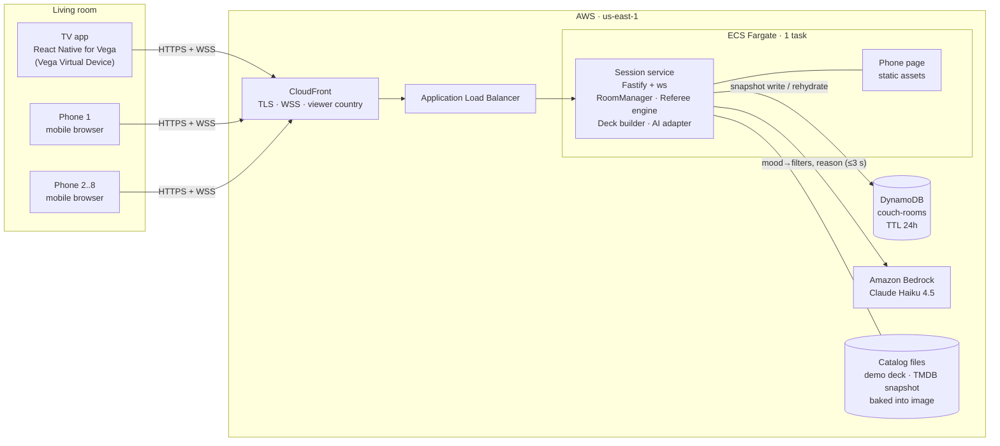
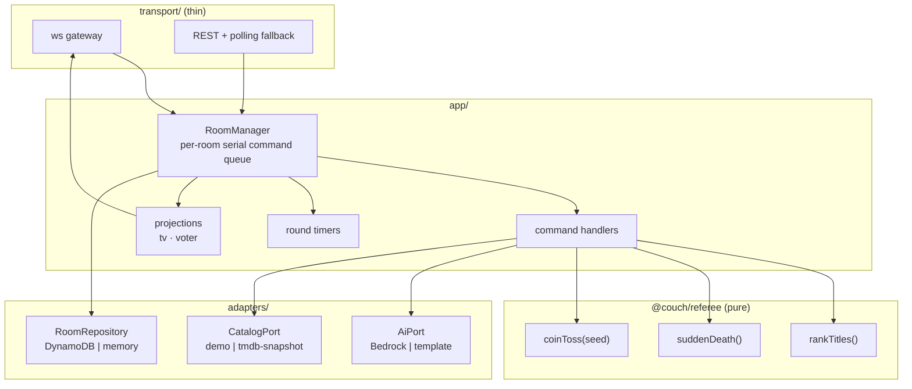
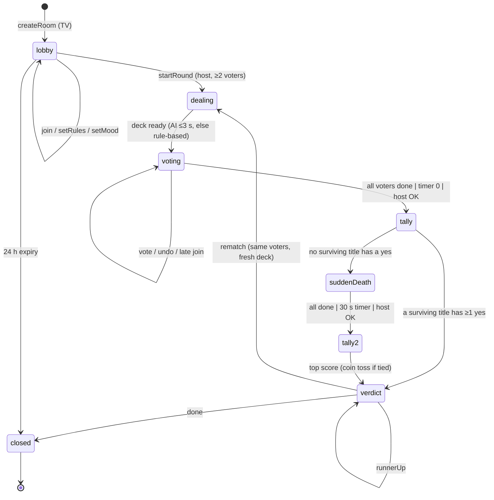
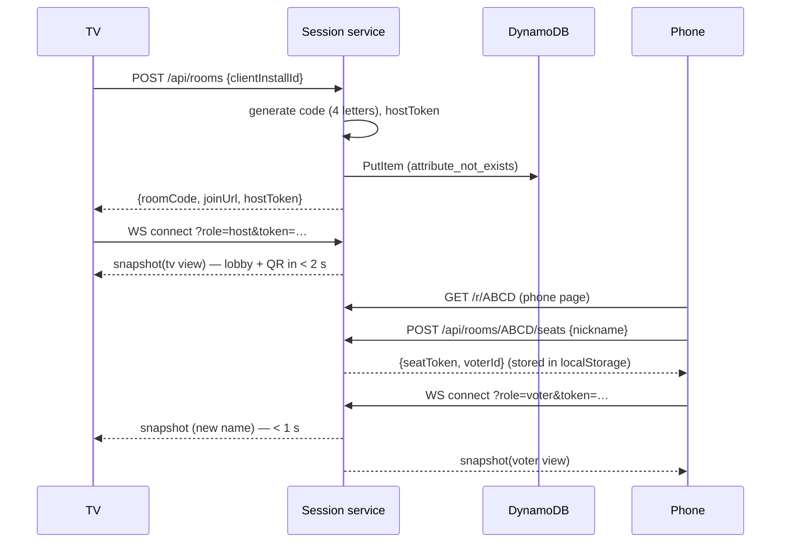

# CouchConsensus: System Architecture

Oct 10, 2026 · Phase 2 (System Architecture) · Source: [Requirements](../../CouchConsensus%20Requirements.md)

This document defines the technical stack, the boundaries between components, and how the system meets the requirements. The decisions behind it are recorded as ADRs in [adr/](adr/README.md), and the data shapes are in [DATA_MODEL.md](DATA_MODEL.md).

## 1. Architecture in one paragraph

One **session service** (Node.js, TypeScript) owns every room, every vote, the round timer and the referee rules. The **TV app** (React Native for Vega) and the **phone page** (a small web app served by the same service) are thin views: they send *commands* and render *snapshots*. The service keeps live rooms in memory, persists a snapshot of each room to **DynamoDB** with a 24-hour TTL, and calls **Amazon Bedrock** only to shape the deck and word the verdict, never to choose the winner. Everything runs behind **CloudFront**, which gives the phones an HTTPS/WSS URL, the viewer's country, and one origin for page, API and socket.

## 2. Guiding principles

| # | Principle | Consequence |
| --- | --- | --- |
| P1 | **Server is the referee.** All game state and rules live in the service. | Clients cannot cheat, disagree, or see each other's votes. Late joiners and reconnects are trivial: just send the current snapshot. |
| P2 | **Clients are projections.** Each client receives a view built *for its audience* (TV, or one specific voter). | Vote privacy (US-7, TV-4) is enforced by construction, not by UI discipline. |
| P3 | **Rules are pure code; AI is decoration.** The referee engine is a pure, deterministic function. | Every verdict is explainable and unit-testable. Bedrock failure can never block a pick (AI-3). |
| P4 | **One language, one repo.** TypeScript everywhere, shared protocol types. | A message shape changes in one place and breaks the build everywhere it's used. |
| P5 | **Demo mode is the default path.** | The video can never show third-party artwork or names (SV-6). Real catalog is an add-on. |
| P6 | **Smallest thing that meets the NFRs.** One service instance, one table, no queues. | 13 days, one builder. Horizontal scale is an explicit non-goal (see §9). |

## 3. Technical stack

### 3.1 Stack by component

| Component | Technology | Version (pin at scaffold) | Notes / ADR |
| --- | --- | --- | --- |
| **TV app** | React Native for Vega | Vega SDK 0.24, RN 0.83 | Track platform. [ADR-0006](adr/0006-typescript-monorepo.md) |
| TV navigation | `@amazon-devices/react-navigation` (Vega port) | ^8 | D-pad focus management |
| TV QR code | `@amazon-devices/react-native-qrcode-svg` 3.0.0 + `@amazon-devices/react-native-svg` | 3.0 | Verified on the VVD (S2). Install with npm; not in the `vega project install` profile. [ADR-0011](adr/0011-qr-code-rendering.md) |
| TV persistence | `@amazon-devices/react-native-async-storage` or MMKV | ~2.1 | Stores host token to restore the room |
| TV animation | `react-native-reanimated` (Vega port) | ~4.0 | Coin toss, verdict reveal (TV-8) |
| TV sound | `@amazon-devices/react-native-w3cmedia` `AudioPlayer` + `MediaSource` | ~2.3.2 | Verified on the VVD (S5): **AAC `.m4a` fed through MSE only**; plain URLs and MP3 fail |
| **Phone page** | Vite + Preact + TypeScript | Vite 8, Preact 11 | ~15 KB gzipped, loads fast on cellular. [ADR-0005](adr/0005-phone-web-client.md) |
| Phone gestures | Native Pointer Events (no library) | — | Swipe + tap fallbacks |
| **Session service** | Node.js + Fastify + `@fastify/websocket` (ws) | Node 22 LTS, Fastify 5 | [ADR-0002](adr/0002-session-service-hosting.md) |
| Validation | Zod | 4.x | Every inbound message and every Bedrock output |
| Logging | pino (Fastify default) → CloudWatch Logs | — | Structured JSON, room code in every line |
| **Referee engine** | Pure TypeScript package `@couch/referee` | — | No I/O, deterministic. [ADR-0007](adr/0007-deterministic-referee-engine.md) |
| **Room store** | Amazon DynamoDB (on-demand) with TTL | — | [ADR-0003](adr/0003-room-state-and-persistence.md) |
| **AI** | Amazon Bedrock, Claude Haiku 4.5 (`us.anthropic.claude-haiku-4-5-20251001-v1:0`), via `@anthropic-ai/bedrock-sdk` `AnthropicBedrock` client | — | Structured outputs, 3 s budget. [ADR-0008](adr/0008-bedrock-ai-integration.md) |
| **Title catalog** | Demo: bundled JSON deck. Real: offline TMDB snapshot with JustWatch providers | — | [ADR-0009](adr/0009-title-catalog-and-region.md) |
| **Edge** | Amazon CloudFront (HTTPS + WebSocket passthrough) | — | Free `*.cloudfront.net` TLS, `CloudFront-Viewer-Country` |
| **Compute** | Amazon ECS on Fargate, 1 task, behind an Application Load Balancer | 0.5 vCPU / 1 GB | [ADR-0002](adr/0002-session-service-hosting.md) |
| **IaC** | AWS CDK v2 (TypeScript) | — | [ADR-0012](adr/0012-infrastructure-as-code.md) |
| Region | `us-east-1` | — | Widest Bedrock model availability |
| **Tests** | Vitest 5 (unit), fast-check (referee properties), Playwright (phone page) | — | Referee engine targets 100 % branch coverage |
| Tooling | pnpm workspaces (`node-linker=hoisted`, single pinned esbuild), TypeScript 7 strict (the TV app keeps the template's 5.8), ESLint, Prettier | — | Hoisted layout required by Vega's Metro (S4) |

### 3.2 What we deliberately do not use

| Not used | Why not |
| --- | --- |
| API Gateway WebSocket + Lambda | The 90-second timer, fan-out to 9 sockets, and per-room serialization all become distributed problems. See ADR-0002. |
| AWS App Runner | No WebSocket support. |
| Redis / ElastiCache | One process holds live state; DynamoDB covers restart recovery. |
| Cognito / any auth provider | Requirement: no accounts. Capability tokens instead (ADR-0010). |
| A phone-side framework with a large runtime (Next.js, full React) | Cold load on cellular is part of the 3-minute budget. |
| LLM-generated title names | Hallucinated titles. Bedrock may only choose from catalog IDs we give it. |

## 4. System context and containers



The phones never talk to the TV directly. That removes every local-network concern (same Wi-Fi, mDNS, client isolation) and works on cellular.

## 5. Boundaries and responsibilities

### 5.1 Ownership

| Concern | TV app | Phone page | Session service | Bedrock |
| --- | --- | --- | --- | --- |
| Room lifecycle (create, phases, expiry) | requests | — | **owns** | — |
| Room code + join URL | displays | parses from URL | **generates** | — |
| Ground rules | edits via D-pad, sends | — | **validates, stores** | — |
| Voter seats, nicknames | displays | requests | **owns** | — |
| Moods | — | submits | **stores, aggregates** | interprets |
| Deck | — | renders | **builds** | suggests shortlist (IDs only) |
| Votes | **never sees** | casts own | **owns** | **never sees individual votes** |
| Timer | renders countdown | renders countdown | **owns `endsAt`** | — |
| Round end | sends `endRound` | — | **decides** | — |
| Ranking / winner / coin toss | animates result | displays | **computes (referee engine)** | — |
| Verdict sentence | displays | displays | template, or asks AI | writes one sentence from aggregates |
| Where-to-watch / region | displays | displays | **resolves** | — |

### 5.2 Trust boundaries

1. **Internet → CloudFront.** Everything outside is untrusted: phones, TV, and request bodies. All inbound messages are Zod-validated and size-limited (8 KB).
2. **Capability tokens.** No accounts. The service issues an unguessable token per role: a *host token* to the TV that creates the room, a *seat token* to each voter. Commands are authorised by token, not by connection. See [ADR-0010](adr/0010-identity-privacy-and-tokens.md).
3. **Service → Bedrock.** Bedrock output is untrusted input too. It is schema-validated, IDs are checked against the candidate list, and the reason sentence is length- and content-checked before display.
4. **Projection boundary.** The only code path that serialises state for a client is `project(room, audience)`. A unit test asserts that a TV projection never contains a vote value and that a voter projection contains only that voter's votes.

### 5.3 Module boundaries inside the session service



Rules for this layout:

- `@couch/referee` imports nothing from Node, AWS or the network. It is shared with tests and could run on the TV.
- Transport code never touches room state; it hands a validated command to `RoomManager` and receives projections back. WebSocket and HTTP polling therefore share one implementation (the Vega WebSocket fallback costs one adapter, not a rewrite).
- Every adapter has an in-memory/local implementation, so the whole system runs with `pnpm dev` and no AWS account.

### 5.4 Concurrency model

Each room has a **serial command queue** inside `RoomManager`. Commands for one room run one at a time, so there are no races between two phones voting, the timer firing, and the host pressing OK. Different rooms run concurrently. Because one process owns all rooms (ADR-0002), no distributed locking is needed.

## 6. Room lifecycle



`dealing`, `tally` and `tally2` are transient (they never wait on a person) and appear to clients only as a brief "Referee is thinking…" state. The four phases clients design for are the four in the requirements: **lobby, voting, sudden death, verdict**.

Sudden death uses its own 30-second timer (5 cards), which keeps the worst case at 90 s + 30 s + overhead, still inside 3 minutes.

## 7. Key flows

### 7.1 Create room and join (US-1, US-3)



### 7.2 Vote (US-4, US-5, US-7)

1. Phone sends `{type:"vote", round, cardIndex, value, cmdId}`.
2. `RoomManager` enqueues; handler checks seat token, phase, `cardIndex === voter.position`, veto/super-yes allowance, and `cmdId` idempotency.
3. State mutates, `rev` increments, snapshot write is scheduled (coalesced).
4. Service pushes a **voter projection** to that phone (with its own vote) and a **TV projection** to the TV (progress count only).
5. If every active voter has finished, the round ends immediately.

Target: phone tap → TV update under 1 s (SV-2). Budget: ~50–150 ms network each way plus < 5 ms processing.

### 7.3 Round end and verdict (US-8, US-9, SV-3, SV-4, AI-2, AI-3)

1. Trigger: all done, timer fires, or host `endRound`.
2. Phase → `tally`. Unreached cards count as No. Referee engine returns a ranked list (or "sudden death needed").
3. Winner known immediately. In parallel: **template reason** is computed, and a **Bedrock reason** request starts with a 2.5 s timeout.
4. Verdict is pushed as soon as the AI reason arrives or the timeout fires, whichever is first, so always within 3 s of round end.
5. If the ranking needed a coin toss, the verdict carries `coinToss: {candidates, winner}` and the TV animates it before revealing.

### 7.4 Reconnect (US-12, resilience NFR)

- **Phone**: on page load, reads `seatToken` from `localStorage` for that room code, reconnects, and receives its current position. If the round ended meanwhile it lands on the result.
- **TV**: stores `hostToken` + `roomCode`; on relaunch it offers "Resume room ABCD" while the room is alive.
- **Service restart**: rooms are rehydrated lazily from DynamoDB on the first command or connection for that code. A voting round whose `endsAt` has passed is tallied on rehydrate.
- A disconnected voter never blocks: the "all done" check only waits for voters who are connected or dropped < 15 s ago, and the timer always ends the round.

### 7.5 Transport fallback (risk: Vega WebSocket)

If WebSocket proves unreliable on Vega, the TV switches to `GET /api/rooms/:code/view?since=<rev>` once a second and `POST /api/rooms/:code/commands`. Same projections, same handlers. Phones keep WebSocket.

## 8. Non-functional requirements → design

| NFR | Target | How the design meets it | Verified by |
| --- | --- | --- | --- |
| Lobby time | < 2 s | One PutItem + local QR render; no AI on this path | Timed log line `room.created` → TV first render |
| Vote → TV | < 1 s | In-memory state, direct WS push, DynamoDB write off the critical path | Server timestamps in snapshot; scripted 8-phone load test |
| Verdict | < 3 s of round end | Pure ranking (< 1 ms); AI reason with 2.5 s hard timeout and template fallback | Unit test with a stalled AI adapter |
| TV usability | D-pad only, readable | Focusable components, 10-foot type scale (min 28 px body at 1080p), visible focus ring | Manual D-pad pass on the VVD each day |
| Phone support | iOS Safari, Android Chrome | No exotic APIs; Pointer Events; `localStorage` with in-memory fallback | Playwright WebKit + Chromium mobile profiles |
| Privacy | No accounts, nickname only, 24 h deletion, votes never shown | Capability tokens; projection boundary; DynamoDB TTL + read-side expiry check | Projection unit tests; TTL attribute test |
| Resilience | Dropped phone never blocks | Timer authority on server; activity window; lazy rehydrate | Chaos test: kill a phone mid-round |
| Content | Adult excluded, nickname ≤ 12 | Catalog filter `adult === false` by default; Zod `max(12)` + trim + control-char strip | Unit tests |

## 9. Explicit limits (accepted for v1)

- **Single instance.** One Fargate task holds all live rooms. A deploy or crash drops sockets for a few seconds; clients reconnect and the room rehydrates from DynamoDB. Scaling out would need sticky routing by room code. Out of scope for the hackathon.
- **Films only** in v1 (open question resolved in the requirements).
- **TV-9 (open streaming app)** is not demonstrable on the virtual device; the verdict screen only shows where to watch.
- **Up to 8 voters** per room; the 9th seat request returns `ROOM_FULL`.

## 10. Repository layout

```
couchconsensus/
├── apps/
│   ├── tv/                 React Native for Vega app
│   ├── phone/              Vite + Preact phone page (built into server/public)
│   └── server/             Fastify session service
├── packages/
│   ├── protocol/           Zod schemas + TS types for REST, WS, projections
│   ├── referee/            Pure ranking engine + tests
│   ├── catalog/            Catalog types, demo deck JSON, original placeholder art
│   └── theme/              Design tokens shared by TV and phone
├── infra/                  AWS CDK app
├── scripts/                dev helpers (TV server URL, LAN IP); later: catalog ingest, load test
├── design/                 brand files, screen previews, design README (Figma is the source)
├── docs/architecture/      this folder
└── FRICTION_LOG.md         kept daily (submission bonus)
```

Vega's Metro bundler resolves `packages/*` from the workspace when pnpm uses `node-linker=hoisted`, Metro has `watchFolders`/`nodeModulesPaths` set to the workspace root, and Babel has `@babel/plugin-transform-export-namespace-from` (for Zod 4). Verified in spike S4; config in `spikes/s4-monorepo/`.

## 11. Day 1–2 spikes (before feature work)

These retire the risks in the requirements. Each has a pass condition and a pre-agreed fallback. **Results (Oct 10): [spikes/RESULTS.md](../../spikes/RESULTS.md)**: S1, S4, S5 pass; S2 renders (scan pending); S3 and S6 blocked on AWS account activation.

| Spike | Pass condition | Fallback if it fails |
| --- | --- | --- |
| S1 · WebSocket on VVD | TV holds a `wss://` connection to a CloudFront URL for 5 minutes and receives 1 msg/s | HTTPS polling transport (§7.5) |
| S2 · QR on VVD | `react-native-qrcode-svg` renders a scannable 33×33 code at 1080p | Server-rendered PNG at `/api/rooms/:code/qr.png` (ADR-0011) |
| S3 · Bedrock access | Haiku 4.5 returns schema-valid JSON from `us-east-1` in < 1.5 s p50 | Different model ID/region; template-only (AI-3) still passes Must |
| S4 · Monorepo + Metro | TV app imports `@couch/protocol` and builds | Copy-in prebuild step |
| S5 · Sound on VVD | A short whistle plays on the verdict | Visual-only verdict (TV-8 is Should) |
| S6 · CloudFront WS | Phone on cellular joins via `*.cloudfront.net` | ALB DNS with ACM cert on a custom domain |

## 12. Traceability

| Requirement | Where it lives |
| --- | --- |
| TV-1…TV-9 | `apps/tv`; TV-4 enforced by `projections/tv.ts` |
| PH-1…PH-6 | `apps/phone`; PH-2 by seat tokens (ADR-0010) |
| SV-1 | `RoomManager` capacity check; TTL (ADR-0003) |
| SV-2 | WS gateway (ADR-0004) |
| SV-3 | `RoomManager.endRound` triggers (§7.3) |
| SV-4 | `@couch/referee` (ADR-0007) |
| SV-5, SV-6 | `CatalogPort`, deck builder (ADR-0009) |
| SV-7 | `household` record with salted nickname hashes (DATA_MODEL §4.3, ADR-0013), Could |
| AI-1, AI-2, AI-3 | `AiPort` (ADR-0008) |
