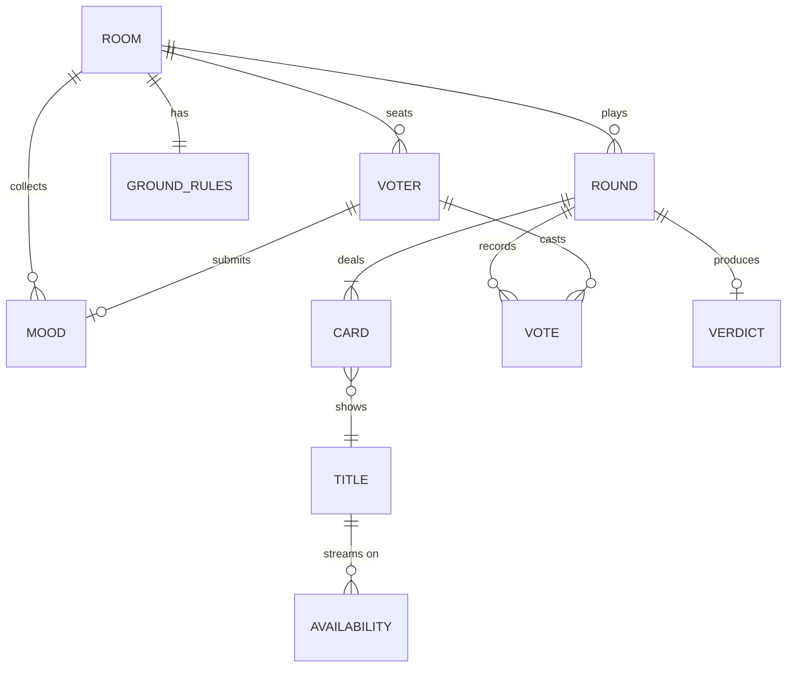

# CouchConsensus: Data Models and Schemas

Oct 10, 2026 · Phase 2 (System Architecture) · See also [ARCHITECTURE.md](ARCHITECTURE.md), [ADRs](adr/README.md)

Server-side room state is implemented in [`apps/server/src/rooms/model.ts`](../../apps/server/src/rooms/model.ts). All shapes below are the source for `packages/protocol` (Zod schemas, TS types inferred with `z.infer`) and `packages/catalog`. Implemented in [`packages/protocol/src`](../../packages/protocol/src); the code is authoritative if the two ever differ. Field names are camelCase on the wire and in DynamoDB. Times are **epoch milliseconds (UTC)** unless the name ends in `Sec`.

## 1. Domain model at a glance



| Entity | Lives in | Lifetime |
| --- | --- | --- |
| Room, Voter, GroundRules, Mood, Round, Card, Vote, Verdict | One room document (memory + DynamoDB) | ≤ 24 h |
| Title, Availability, Service | Catalog JSON (read-only, in the image) | Build-time |
| Household (SV-7, Could) | DynamoDB, separate item | 30 days, nickname hashes only (ADR-0013) |

## 2. Shared primitives

```ts
type RoomCode   = string;   // /^[ABCDEFGHJKMNPQRTUWXY]{4}$/
type VoterId    = string;   // "v_" + 8 base32 chars, unique within room
type TitleId    = string;   // "demo:0042" | "tmdb:603"
type ServiceId  = string;   // "demo:streamco" | "jw:8" (JustWatch provider id via TMDB)
type CountryCode = string;  // ISO 3166-1 alpha-2, e.g. "US"
type EpochMs    = number;

type Phase = "lobby" | "dealing" | "voting" | "tally" | "suddenDeath" | "verdict" | "closed";
type RoundKind = "main" | "suddenDeath";
type VoteValue = "yes" | "no" | "superYes" | "veto";
type MoodChip =
  | "funny" | "cozy" | "thrilling" | "scary" | "romantic"
  | "mindBending" | "epic" | "feelGood" | "familyFriendly" | "short";
```

## 3. Core domain (server-side, authoritative)

### 3.1 Room

```ts
interface Room {
  schemaVersion: 1;
  id: string;                 // ULID; stable even if code is reused after expiry
  code: RoomCode;
  rev: number;                // +1 on every mutation; drives client staleness checks
  phase: Phase;
  createdAt: EpochMs;
  expiresAt: EpochMs;         // createdAt + 24h (SV-1)
  hostTokenHash: string;      // sha256 hex (ADR-0010)
  joinUrl: string;            // what the QR code encodes (built from the request host in production)
  clientInstallId?: string;   // random id the TV generates once; keys SV-7 household memory
  hostRecentCmdIds?: string[];// last 64 TV command ids (idempotency)
  region: CountryCode;        // from CloudFront-Viewer-Country, host-overridable
  regionSource: "cloudfront" | "deviceLocale" | "host" | "default";
  catalogMode: "demo" | "real";
  rules: GroundRules;
  voters: Voter[];            // ≤ 8, join order
  moods: Mood[];              // ≤ 1 per voter
  rounds: Round[];            // history; the last one is current
  currentRoundNo: number;     // 0 before the first round
  verdictCursor: number;      // index into ranking shown on the verdict screen (Runner-up advances it)
  preparedDeck?: PreparedDeck;// speculative deck built in the lobby (ADR-0008)
}
```

### 3.2 GroundRules (US-2, TV-7)

```ts
interface GroundRules {
  services: ServiceId[];      // empty = all services in catalog for this region
  maxRuntimeMin: number | null; // null = no limit; editor steps: 90, 105, 120, 150, null
  kind: "film";               // v1 films only; "series" | "any" reserved
  includeAdult: false;        // fixed false in v1 (Content NFR)
  deckSize: 15;               // PH-3
  roundSeconds: 90;           // Principle 1
}
```

Defaults: all services, no runtime limit, films, adult excluded. "Defaults work with no changes" (US-2) is a test case.

### 3.3 Voter

```ts
interface Voter {
  id: VoterId;
  nickname: string;           // 1–12 chars after sanitising (Content NFR)
  seatTokenHash: string;      // sha256 hex
  joinedAt: EpochMs;
  joinedRoundNo: number;      // 0 = lobby; >0 = late joiner (US-11)
  connected: boolean;         // derived from live sockets; persisted as last known
  lastSeenAt: EpochMs;        // activity window: "active" if connected or lastSeen < 15 s ago
  kicked: boolean;            // host removed the seat (Should)
  recentCmdIds: string[];     // ring buffer, last 64 (idempotency, ADR-0004)
}
```

### 3.4 Mood (US-6, PH-6)

```ts
interface Mood {
  voterId: VoterId;
  chips: MoodChip[];          // 0–3
  text?: string;              // ≤ 80 chars, sanitised; treated as untrusted in prompts
  skipped: boolean;
  at: EpochMs;
}
```

### 3.5 Round, Card, Vote

```ts
interface Round {
  no: number;                 // 1-based within the room; rematch = next number
  kind: RoundKind;            // "suddenDeath" rounds follow a "main" round with the same parentNo
  parentNo?: number;          // for suddenDeath: the main round it resolves
  deck: Card[];               // 15 for main, 5 for sudden death
  deckSource: "ai" | "rules"; // AI-1 vs fallback
  startedAt: EpochMs;
  endsAt: EpochMs;            // startedAt + 90 000 (main) / 30 000 (sudden death)
  endedAt?: EpochMs;
  endReason?: "allDone" | "timer" | "host";
  votes: Record<VoterId, VoterBallot>;
  allowVeto: boolean;         // false in sudden death
  allowSuperYes: boolean;     // false in sudden death
  result?: TallyResult;       // set at tally (from @couch/referee)
  verdict?: Verdict;          // set when the round resolves to a winner
}

interface Card {
  index: number;              // 0..deck.length-1, same order for every voter (US-11)
  titleId: TitleId;
}

interface VoterBallot {
  // votes[i] is the vote on deck[i]; length === voter's position (cards done)
  votes: VoteValue[];
  vetoUsed: boolean;          // derived, cached: votes.includes("veto")
  superYesUsed: boolean;      // derived, cached: votes.includes("superYes")
  finishedAt?: EpochMs;       // set when votes.length === deck.length
}
```

**Why an array per voter instead of a Vote row per card:** swipe order is strictly sequential and undo only removes the last card (PH-3), so `votes.push()` / `votes.pop()` models it exactly and makes "each vote registers once" structural.

### 3.6 Invariants (enforced in command handlers, asserted in tests)

| ID | Invariant |
| --- | --- |
| I1 | `voters.filter(v => !v.kicked).length ≤ 8`; Start requires ≥ 2 (TV-3) |
| I2 | A vote is accepted only if `phase ∈ {voting, suddenDeath}`, `now < endsAt`, and `cardIndex === ballot.votes.length` |
| I3 | ≤ 1 `veto` and ≤ 1 `superYes` per ballot per round; both disallowed in sudden death |
| I4 | Undo is accepted only for `cardIndex === votes.length − 1`, before the round ends; it restores veto/super-yes allowance |
| I5 | `rev` strictly increases on every change a client can see, including timer ticks that end a round; every persisted write is conditional on the previous `rev`. Clients keep the newest view by `rev` and drop older or equal ones, so a change without a bump never reaches the screen. If an `ack`'s `rev` is ahead of the last view for 1.5 s, the client reconnects to fetch the current view |
| I6 | Every round that reaches `verdict` has exactly one winner (`ranking.length ≥ 1`) |
| I7 | A title with any `veto` never appears in `ranking` |
| I8 | No projection sent to the TV contains a `VoteValue` |
| I9 | Nickname unique within the room (case-insensitive); suffix added on collision |

### 3.7 Tally and verdict (from `@couch/referee`)

```ts
interface TallyInput {
  roundNo: number;
  roomId: string;             // coin-toss seed component
  kind: RoundKind;
  deck: Card[];
  voterIds: VoterId[];        // every non-kicked voter seated before endedAt
  ballots: Record<VoterId, VoteValue[]>; // missing entries = "no" (unreached)
  priorSuperYesWinner?: VoterId; // SV-7: voter whose nickname hash matches household memory
}

interface TitleScore {
  titleId: TitleId;
  points: number;             // yes = 1, superYes = 2
  yes: number;                // count of yes + superYes
  superYes: number;
  no: number;                 // includes unreached
  vetoed: boolean;
  unanimous: boolean;         // every voter yes or superYes
}

type TallyResult =
  | { kind: "ranked"; ranking: TitleScore[]; coinToss?: CoinToss; scores: TitleScore[] }
  | { kind: "suddenDeath"; reason: "noYes" | "allVetoed"; scores: TitleScore[] };

interface CoinToss {
  candidates: TitleId[];      // the titles tied after every other tie-breaker
  winner: TitleId;
  seed: number;               // reproducible
}

interface Verdict {
  roundNo: number;            // the main round number this verdict resolves
  winner: TitleId;
  rankingIds: TitleId[];      // for Runner-up (TV-6)
  reason: string;             // ≤ 140 chars, one sentence (US-9)
  reasonSource: "ai" | "template";
  viaSuddenDeath: boolean;
  coinToss?: CoinToss;
  stats: {                    // aggregates only; safe for every audience
    voters: number;
    yes: number;
    superYes: number;
    unanimous: boolean;
  };
  decidedAt: EpochMs;
}
```

### 3.8 PreparedDeck (speculative AI-1 result)

```ts
interface PreparedDeck {
  inputsHash: string;         // hash(rules, moods, region); stale if inputs changed
  titleIds: TitleId[];        // 15
  source: "ai" | "rules";
  filters?: AiDeckFilters;
  builtAt: EpochMs;
}
```

## 4. Persistence: DynamoDB

### 4.1 Table `couch-rooms`

| Attribute | Type | Notes |
| --- | --- | --- |
| `PK` | S | `ROOM#<code>` or `HOUSEHOLD#<clientInstallId>` |
| `SK` | S | `STATE` or `MEMORY` |
| `rev` | N | Optimistic concurrency |
| `doc` | M | Full `Room` document (or `Household`) |
| `ttl` | N | **Epoch seconds**; TTL attribute (`createdAt/1000 + 86 400` for rooms) |
| `updatedAt` | N | Epoch ms |

- Billing: on-demand. No GSIs needed: every access is by room code or install ID.
- Item size: a full 8-voter room with 5 rounds is ~15 KB, far under the 400 KB limit.

### 4.2 Access patterns

| # | Pattern | Operation |
| --- | --- | --- |
| A1 | Create room with a fresh code | `PutItem` with `ConditionExpression: attribute_not_exists(PK)`; on failure, regenerate code. Also allowed if the existing item's `ttl` has passed (`OR #ttl < :nowSec`). |
| A2 | Rehydrate room by code | `GetItem(PK=ROOM#code, SK=STATE)`, then reject if `doc.expiresAt < now` |
| A3 | Persist snapshot | `PutItem` with `ConditionExpression: #rev < :newRev` |
| A4 | Read/update household memory (SV-7) | `GetItem` / `PutItem` on `HOUSEHOLD#id` |

### 4.3 Household (SV-7, Could)

Decision in [ADR-0013](adr/0013-household-tiebreak-memory.md): no nickname is stored, only a salted hash.

```ts
interface Household {
  clientInstallId: string;    // random id generated once by the TV app
  salt: string;               // 16 random bytes, base64; per household, created on first write
  lastSuperYesWin?: {
    nicknameHash: string;     // HMAC-SHA256(pepper, salt + normalise(nickname)), hex
    at: EpochMs;
  };
  ttl: number;                // now + 30 days, epoch seconds; refreshed on each write
}

// normalise(n) = n.trim().toLowerCase().normalize("NFKC")
```

Used only as a tie-breaker *before* the coin toss: if exactly one tied title got a super-yes from a voter whose nickname hash matches `lastSuperYesWin.nicknameHash`, that title wins. Updated when a title wins and at least one super-yes went to it (the last such voter in join order is recorded).

## 5. Wire protocol

### 5.1 REST endpoints

| Method & path | Auth | Body → Response | Req |
| --- | --- | --- | --- |
| `POST /api/rooms` | none (rate-limited) | `{clientInstallId, deviceLocale?}` → `{roomCode, joinUrl, hostToken, region}` | US-1 |
| `POST /api/rooms/:code/seats` | none (rate-limited) | `{nickname}` → `{voterId, seatToken, nickname}` | US-3 |
| `GET  /api/rooms/:code/view?since=<rev>` | Bearer host/seat | → `TvView \| VoterView` or `204` | Fallback (ADR-0004) |
| `POST /api/rooms/:code/commands` | Bearer host/seat | `ClientCommand` → `Ack` | Fallback |
| `GET  /api/rooms/:code/qr.png` | none | → PNG | ADR-0011 |
| `GET  /r/:code` | none | → phone page | PH-1 |
| `GET  /healthz` | none | → `{ok:true, version}` | Ops |
| `GET  /ws` | `hello` message | WebSocket upgrade | SV-2 |

### 5.2 Client → server messages

Every message is a JSON object with a `type`. Commands carry `cmdId` (UUID v4).

```ts
type ClientMessage =
  | { type: "hello"; roomCode: RoomCode; role: "host" | "voter"; token: string; lastRev?: number }
  | { type: "ping"; t: EpochMs }
  | ClientCommand;

type ClientCommand =
  // host (TV)
  | { type: "setRules"; cmdId: string; rules: Partial<Pick<GroundRules, "services" | "maxRuntimeMin">> & { region?: CountryCode } }
  | { type: "startRound"; cmdId: string }
  | { type: "endRound"; cmdId: string }                       // US-8
  | { type: "runnerUp"; cmdId: string }                       // TV-6
  | { type: "rematch"; cmdId: string }                        // TV-6
  | { type: "kickVoter"; cmdId: string; voterId: VoterId }
  | { type: "closeRoom"; cmdId: string }                      // "Done"
  // voter (phone)
  | { type: "setMood"; cmdId: string; chips: MoodChip[]; text?: string; skipped?: boolean }
  | { type: "vote"; cmdId: string; roundNo: number; cardIndex: number; value: VoteValue }
  | { type: "undo"; cmdId: string; roundNo: number; cardIndex: number }
  | { type: "leave"; cmdId: string };
```

### 5.3 Server → client messages

```ts
type ServerMessage =
  | { type: "welcome"; role: "host" | "voter"; voterId?: VoterId; protocol: 1 }
  | { type: "view"; view: TvView | VoterView }            // full projection, see §6
  | { type: "ack"; cmdId: string; ok: true; rev: number }   // rev: the room after this command (resync check)
  | { type: "nack"; cmdId: string; ok: false; error: ErrorCode; message: string } // separate type so the union is discriminated
  | { type: "pong"; t: EpochMs; serverNow: EpochMs }
  | { type: "error"; error: ErrorCode; message: string; fatal: boolean };

type ErrorCode =
  | "BAD_MESSAGE" | "UNAUTHORIZED" | "ROOM_NOT_FOUND" | "ROOM_EXPIRED" | "ROOM_FULL"
  | "WRONG_PHASE" | "NOT_ENOUGH_VOTERS" | "STALE_CARD" | "ROUND_OVER"
  | "VETO_USED" | "SUPER_YES_USED" | "NOT_ALLOWED_THIS_ROUND"
  | "NICKNAME_INVALID" | "RATE_LIMITED" | "NO_RUNNER_UP" | "INTERNAL";
```

Limits: inbound message ≤ 8 KB; ≤ 20 commands/s per socket; the server closes with code 4401 (unauthorised), 4404 (room gone) or 4408 (idle).

## 6. Projections (what each audience may see)

Built only by `project(room, audience)`. Titles are embedded as display-ready `TitleCard`s so clients never need the catalog.

### 6.1 Common pieces

```ts
interface TitleCard {
  id: TitleId;
  title: string;
  year: number;
  runtimeMin: number;
  genres: string[];           // display names, max 3
  logline: string;            // ≤ 120 chars
  posterUrl: string;          // same-origin path for demo; TMDB CDN in real mode
  availability: { serviceName: string; type: "subscription" | "free" | "rent" | "buy" }[];
}

interface TimerView { endsAt: EpochMs; serverNow: EpochMs; durationMs: number }
```

### 6.2 TvView

```ts
interface TvView {
  audience: "tv";
  rev: number;
  serverNow: EpochMs;
  roomCode: RoomCode;
  joinUrl: string;
  phase: "lobby" | "dealing" | "voting" | "tally" | "suddenDeath" | "verdict" | "closed";
  rules: GroundRules & { region: CountryCode; availableServices: { id: ServiceId; name: string }[] };
  voters: {
    id: VoterId; nickname: string; connected: boolean;
    moodDone: boolean;
    progress: { done: number; total: number }; // counts only, never values (TV-4, I8)
    finished: boolean;
  }[];
  canStart: boolean;          // ≥ 2 active voters (TV-3)
  round?: { no: number; kind: RoundKind; timer: TimerView; deckSize: number };
  verdict?: {
    title: TitleCard;         // ranking[verdictCursor]
    reason: string;
    isRunnerUp: boolean;
    hasNextRunnerUp: boolean;
    viaSuddenDeath: boolean;
    coinToss?: { candidates: TitleCard[]; winnerId: TitleId };
    stats: Verdict["stats"];
  };
}
```

### 6.3 VoterView

```ts
interface VoterView {
  audience: "voter";
  rev: number;
  serverNow: EpochMs;
  roomCode: RoomCode;
  phase: TvView["phase"];
  me: {
    id: VoterId; nickname: string;
    mood?: Pick<Mood, "chips" | "text" | "skipped">;
    ballot?: {                // current round only
      votes: VoteValue[];     // MY votes only
      vetoAvailable: boolean;
      superYesAvailable: boolean;
      finished: boolean;
    };
  };
  roomSize: number;           // voter count, no names needed on the phone
  round?: { no: number; kind: RoundKind; timer: TimerView; deck: TitleCard[];
            allowVeto: boolean; allowSuperYes: boolean };
  result?: {                  // PH-4, Result screen
    title: TitleCard;
    reason: string;
    myVote: VoteValue | "notReached" | "notInRound";
  };
}
```

## 7. Catalog schema (`packages/catalog`)

```ts
interface CatalogFile {
  schemaVersion: 1;
  mode: "demo" | "real";
  generatedAt: string;        // ISO date
  attribution?: string[];     // real mode: TMDB + JustWatch notices
  services: Service[];
  titles: Title[];
}

interface Service {
  id: ServiceId;
  name: string;               // demo: invented ("StreamCo"); real: provider name
  logoUrl?: string;           // never shown in demo mode (SV-6)
  regions: CountryCode[];
}

interface Title {
  id: TitleId;
  kind: "film";
  title: string;
  year: number;
  runtimeMin: number;
  genres: Genre[];            // controlled list below
  tags: string[];             // free-form tone tags used by mood matching: "heist", "slow-burn"
  logline: string;            // ≤ 120 chars
  adult: boolean;             // always filtered out in v1
  certification?: string;     // e.g. "PG-13", per region in real mode
  popularity: number;         // 0–100, normalised
  posterPath: string;         // demo: /art/demo-0042.webp
  availability: Record<CountryCode, { serviceId: ServiceId; type: "subscription" | "free" | "rent" | "buy" }[]>;
  // demo titles use the pseudo-country "ZZ" (region-agnostic)
}

type Genre =
  | "action" | "adventure" | "animation" | "comedy" | "crime" | "documentary"
  | "drama" | "family" | "fantasy" | "horror" | "mystery" | "romance"
  | "scienceFiction" | "thriller" | "war" | "western" | "music" | "history";
```

Demo deck requirements (SV-6): ≥ 60 invented titles, ≥ 3 invented services, every genre in `Genre` covered by ≥ 2 titles, runtimes spread 80–170 min so the runtime rule visibly changes the deck, all art original.

Rule-based mood mapping lives next to the catalog as data, e.g. `{ "cozy": { boost: ["family","comedy","animation"], avoid: ["horror"] } }`.

## 8. AI schemas (Bedrock I/O)

### 8.1 AI-1: mood → deck

```ts
// request (built by the server)
interface AiDeckRequest {
  rules: { maxRuntimeMin: number | null; region: CountryCode };
  moods: { chips: MoodChip[]; text?: string }[]; // no names, order shuffled
  candidates: { id: TitleId; title: string; year: number; genres: Genre[]; tags: string[]; logline: string }[]; // ≤ 60
  deckSize: 15;
}

// response (structured output, then Zod-validated)
interface AiDeckResponse {
  filters: { genresBoost: Genre[]; genresAvoid: Genre[]; tones: string[] };
  shortlist: TitleId[];       // must be ⊆ candidates; server dedupes and tops up to 15
}
type AiDeckFilters = AiDeckResponse["filters"];
```

### 8.2 AI-2: tally → reason

```ts
interface AiReasonRequest {
  winner: { title: string; year: number; genres: Genre[]; runtimeMin: number };
  runnerUp?: { title: string };
  stats: { voters: number; yes: number; superYes: number; unanimous: boolean };
  path: "normal" | "suddenDeath" | "coinToss";
  roomMoods: MoodChip[];      // top 3 by frequency, no free text
}

interface AiReasonResponse {
  reason: string;             // 1 sentence, ≤ 140 chars, mentions no other title than winner/runnerUp
}
```

## 9. Example: room document mid-round

```json
{
  "schemaVersion": 1,
  "id": "01JAB3Q9X7M2K8V4R6T0W1Y5ZC",
  "code": "KDRM",
  "rev": 57,
  "phase": "voting",
  "createdAt": 1791648000000,
  "expiresAt": 1791734400000,
  "hostTokenHash": "9f2c…",
  "region": "US",
  "regionSource": "cloudfront",
  "catalogMode": "demo",
  "rules": { "services": [], "maxRuntimeMin": 120, "kind": "film", "includeAdult": false, "deckSize": 15, "roundSeconds": 90 },
  "voters": [
    { "id": "v_7h2k9q3m", "nickname": "Sam", "seatTokenHash": "a1…", "joinedAt": 1791648021000, "joinedRoundNo": 0, "connected": true, "lastSeenAt": 1791648150000, "kicked": false, "recentCmdIds": [] },
    { "id": "v_c4p8w2n6", "nickname": "Ada", "seatTokenHash": "b2…", "joinedAt": 1791648025000, "joinedRoundNo": 0, "connected": true, "lastSeenAt": 1791648151000, "kicked": false, "recentCmdIds": [] },
    { "id": "v_m9t3x5r1", "nickname": "Kofi", "seatTokenHash": "c3…", "joinedAt": 1791648110000, "joinedRoundNo": 1, "connected": false, "lastSeenAt": 1791648140000, "kicked": false, "recentCmdIds": [] }
  ],
  "moods": [
    { "voterId": "v_7h2k9q3m", "chips": ["funny", "cozy"], "skipped": false, "at": 1791648040000 },
    { "voterId": "v_c4p8w2n6", "chips": ["thrilling"], "text": "something with a heist", "skipped": false, "at": 1791648045000 }
  ],
  "rounds": [
    {
      "no": 1, "kind": "main",
      "deck": [ { "index": 0, "titleId": "demo:0012" }, { "index": 1, "titleId": "demo:0031" } ],
      "deckSource": "ai",
      "startedAt": 1791648090000, "endsAt": 1791648180000,
      "allowVeto": true, "allowSuperYes": true,
      "votes": {
        "v_7h2k9q3m": { "votes": ["yes", "no", "superYes"], "vetoUsed": false, "superYesUsed": true },
        "v_c4p8w2n6": { "votes": ["veto", "yes"], "vetoUsed": true, "superYesUsed": false },
        "v_m9t3x5r1": { "votes": ["no"], "vetoUsed": false, "superYesUsed": false }
      }
    }
  ],
  "currentRoundNo": 1,
  "verdictCursor": 0
}
```

(Deck truncated to 2 cards for readability; a real main round has 15.)

## 10. Schema evolution

- `schemaVersion` on the room document and catalog file; the server refuses to rehydrate a newer version and migrates older ones in `migrations/room.ts`.
- `protocol: 1` in `welcome`; clients built against a different protocol show "Please refresh" (phone) or "Update the app" (TV). Phone and server ship in the same image, so only the TV can drift.

## Resolved decisions (2026-10-10)

1. **SV-7 vs the 24 h privacy rule:** household memory stores salted, peppered nickname hashes only ([ADR-0013](adr/0013-household-tiebreak-memory.md)).
2. **Bedrock model:** start with Claude Haiku 4.5 ([ADR-0008](adr/0008-bedrock-ai-integration.md)).
3. **Real-mode catalog:** TMDB + JustWatch offline snapshot ([ADR-0009](adr/0009-title-catalog-and-region.md)).
